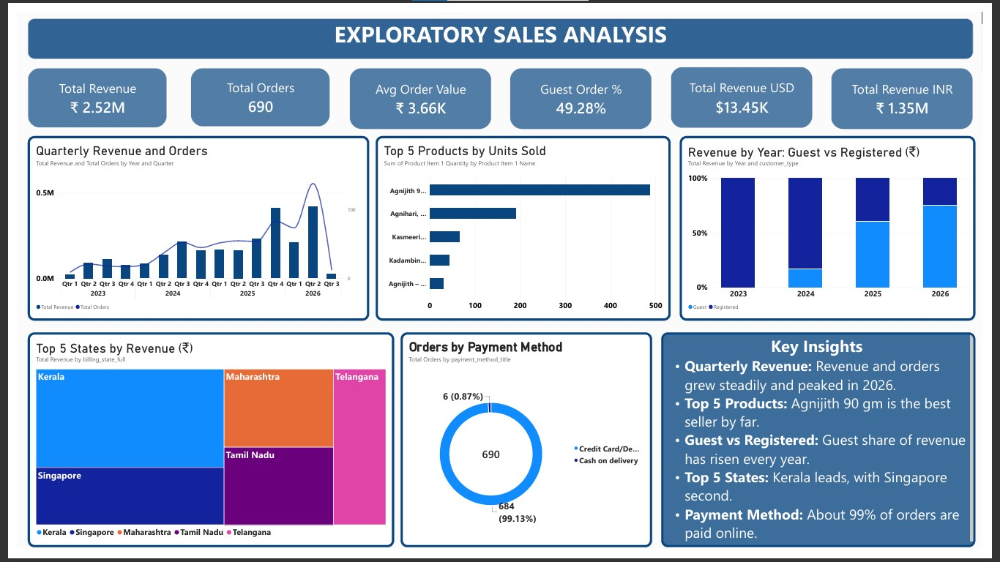

# Exploratory Sales Analysis: Jagadha by Padanjaly WooCommerce Orders

A data cleaning and exploratory sales analysis project built in Power BI. It covers 690 orders from the Jagadha by Padanjaly WooCommerce store (January 2023 to May 2026) and ends in a one-page dashboard, a written report with insights, and business recommendations.



## Project objective

Analyse the sales data to find key patterns and trends, top-performing products and revenue drivers, calculate basic sales KPIs, and point out insights or anomalies for further analysis.

## About the data

| Item | Detail |
| --- | --- |
| Source | WooCommerce orders export of Jagadha by Padanjaly (Padanjali Ayurvedic (P) Ltd, Kerala) |
| Rows | 690 orders (one row per order) |
| Columns | 72 |
| Period | January 2023 to May 2026 |
| Currencies | INR and USD |

> **The raw dataset is not included in this repository.** It contains customer and order details, so only the report and the dashboard image are shared.

## Tools used

- **Power BI** for the dashboard, with **Power Query** for cleaning and **DAX** for measures
- **FBIL USD/INR reference rates** (Financial Benchmarks India) for the currency conversion
- **Microsoft Word** for the report

## Data cleaning

- Checked and corrected the data type of every column.
- Split `order_date` and `paid_date` into separate date and time columns.
- Converted USD orders to INR using the historical FBIL exchange rate for each order's date, and saved the result in a new column.
- Kept the zero-value tax and discount columns, which show that the store charges no tax and offers no discounts.
- Kept `customer_id = 0` as guest customers and counted them separately.
- Verified billing and shipping state and country against the postcode and city, and wrote the full names into new columns.
- Split `line_item_1` and `line_item_2` into Product Item columns (name, id, SKU, quantity, total, subtotal).
- Left null values as they are, because they carry meaning (for example unpaid orders).

## Dashboard

One page with 6 KPI cards, 5 charts and a Key Insights box:

- **KPIs:** Total Revenue, Total Orders, Average Order Value, Guest Order %, Total Revenue (USD), Total Revenue (INR)
- **Charts:** Quarterly revenue and orders (line and bar), top 5 products by units sold, revenue by year for guest vs registered customers, top 5 states by revenue (treemap), orders by payment method (donut)

Example measures:

```DAX
Total Revenue = SUM(Orders[order_subtotal_INR])
Total Orders = DISTINCTCOUNT(Orders[order_id])
Avg Order Value = DIVIDE([Total Revenue], [Total Orders])
Guest Order % = DIVIDE(CALCULATE([Total Orders], Orders[customer_id] = 0), [Total Orders])
Total Revenue USD = CALCULATE(SUM(Orders[order_subtotal]), Orders[order_currency] = "USD")
```

## Key insights

1. **Revenue and order size:** ₹2.52M from 690 orders, with an average order value of about ₹3.66K. A few price points (₹510, ₹2,100, ₹4,200) appear most, so orders are built on a few core products.
2. **Growth:** quarterly revenue and orders rose steadily and peaked in 2025 and 2026. The drop in the last quarter is only partial data.
3. **Best seller:** Agnijith 90 gm sold about 490 units, far ahead of Agnihari (about 190).
4. **Guests:** 49.28% of orders are guest orders, and the guest share of revenue rises every year.
5. **Locations:** Kerala leads, followed by Singapore, Maharashtra, Tamil Nadu and Telangana.
6. **Payments:** 99.13% of orders are paid online, and only 6 were cash on delivery.
7. **Points to check:** the last quarter is incomplete, a few orders are above ₹10,000, and the product chart reads Product Item 1 only.

## Recommendations

1. Offer clearer bulk and repeat-order deals on Agnijith.
2. Bundle the low sellers (Kasmeerini, Kadambini) with the popular products and promote them in their season.
3. Run marketing campaigns where demand is already strong, such as Kerala, Singapore and the other top states.
4. Turn guest customers into registered customers with a sign-up invitation after checkout.
5. Plan campaigns around seasons, and confirm the monthly pattern first.

## Limitations

- There are no cost columns, so profit cannot be analysed.
- The product chart counts units from Product Item 1 only, so products ordered second are not included, and a pack counts as one unit.
- The reasons given for the insights are likely explanations and need further data to confirm.

## Repository contents

```
├── README.md
├── report/
│   └── Jagadha_Sales_Analysis_Final_Report.docx
└── images/
    └── sales_dashboard.jpg
```

## Author

**Christy Andrews**
Data analysis project, October 2026
